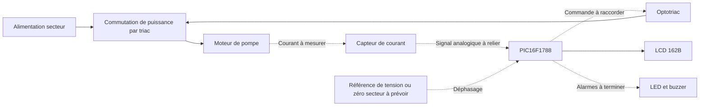

# Fonctionnement et architecture

Retour : [[00 - Accueil]] · Suite : [[04 - Anomalies et verifications]]

## Besoin prévu par les documents

La pré-étude prévoit la surveillance d'une pompe vide-cave, des informations de courant et de déphasage, un autotest tous les trois jours d'une durée maximale d'une minute, un affichage LCD et des alertes par LED/buzzer. Les seuils et les données de la plaque moteur sont à compléter.

## Chaîne prévue

Ce synoptique expose **l'intention**, pas une garantie que ces connexions sont présentes dans les fichiers actuels. Les pointillés signalent des interfaces à terminer ou à définir.

## Blocs présents dans le schéma G206

| Bloc | Rôle prévu | État à comprendre |
| --- | --- | --- |
| U1, PIC16F1788 | Acquisition, décision, affichage et commande | Firmware absent ; configuration de RA6/RA7 et des entrées analogiques à préciser |
| U3, symbole ACS756 | Mesure du courant moteur | Voie IP+/IP− non câblée ; sortie AN0 différente du net « capteur de courant » du PIC |
| U2, symbole FODM3011 / valeur « optotriac » | Interface de commande vers la puissance | Référence réelle à choisir ; net de commande PIC différent de RB2 côté R7 |
| TRIAC1 | Commutation de la pompe | Référence fabricant et empreinte absentes ; pas encore sur le PCB |
| LCD1, 162B | Affichage | Brochage particulier étudié ; ne pas lui appliquer automatiquement celui d'un LCD générique |
| BZ1 | Alerte sonore | Empreinte absente, polarité à clarifier |
| Alimentation / reset / ICSP | Alimentation et programmation du PIC | Base nominale identifiée ; découplage physique à revoir |

La carte ne dispose pas de voie tension ou de détection du zéro permettant de produire la mesure de déphasage décrite dans la pré-étude. Le symbole AC n'est pas un bornier secteur phase/neutre complet.

## Limites de lecture

Les valeurs « 230 V », « environ 300 W » ou « 5 A » présentes dans la variante sont des hypothèses historiques, pas des mesures confirmées de cette pompe. Les choix de triac, optotriac, isolement et protections nécessitent les données réelles. Le [rapport d'analyse](../Analyse_G206_2026-10-12/RAPPORT_ANALYSE.md) distingue les constats de connexion, les vérifications sur documents et les hypothèses.

Anatomy sert à **visualiser et expliquer** ces blocs. Le schéma et le PCB KiCad restent les sources techniques de la réalisation.
