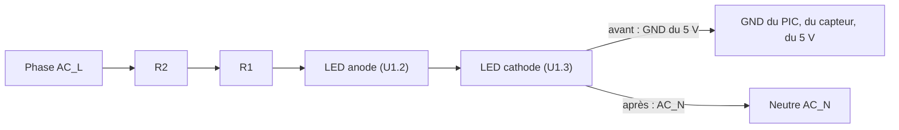

# Rapport : routage de la carte V2 (16/11/2026)

> [!abstract] En bref
> La carte V2 (triac, MOC3041, 6N136, ACS756) est entièrement re-routée **en simple face, couche B.Cu (bleu)**. Pistes 230 V en **2 mm**, pistes 5 V en **1 mm**, au moins **3 mm** entre 230 V et 5 V, aucun angle droit. KiCad ne trouve plus **aucune erreur ni aucun avertissement** (DRC 0, ERC 0, carte et schéma cohérents).
>
> L'erreur du 6N136 (cathode sur le GND du 5 V) est **corrigée** : patte 3 sur AC_N, diode de protection D1 ajoutée, zone de U1 re-routée. Voir [[#5. Correction du 6N136 (U1)]].
>
> La sortie du 6N136 arrive maintenant au PIC par **J6 (RB4 + GND)**, et R1/R2 passent en **47 kΩ 1 W**. Voir [[#6. Sortie RB4 et résistances R1 R2]].

![[Routage V2 avant apres.png]]
*À gauche le routage de départ, à droite le routage final.*

## Où sont les fichiers

| Quoi | Où |
|---|---|
| Copie propre du projet KiCad (à utiliser) | `03_Electronique/G206A_CAMEL_TP_CAO V2 routée 2026-11-16` |
| Gerbers et perçage (B.Cu, Edge.Cuts, .drl) | même dossier, sous-dossier `Gerber` |
| Dossier de travail d'origine | `Documents/bordel camel a trier/G206A_CAMEL_TP_CAO V2` |
| Sauvegardes de chaque étape | dossier d'origine, `G206_CAMEL_TP_CAO-backups` |

Le dossier `03_Electronique/G206A_CAMEL_TP_CAO V2` (version d'octobre) n'a pas été modifié.

## 1. Rangement du dossier

Dans le dossier d'origine :

- **Supprimé** (KiCad les recrée) : les 3 fichiers `~*.lck` restés après un arrêt brutal de KiCad, et `fp-info-cache`.
- **Mis de côté dans `_a_supprimer`** (5,5 Mo, rien n'est effacé) : les Gerbers de février (ancienne carte SAE22), deux zips de février, l'ancien schéma `avant_detection_zero`, une copie de restauration, deux nomenclatures CSV périmées (elles listaient un buzzer et une LED qui ne sont plus sur le schéma) et 22 sauvegardes zip en double.

## 2. Problèmes trouvés au départ

| Problème | Gravité |
|---|---|
| Piste **AC_L (230 V) passée sous l'optotriac, entre ses deux rangées**, à 1 mm d'une piste GND : l'isolement du MOC3041 était annulé | Grave |
| Moteur L à 1,0–1,5 mm du +5V, AC_L à 1,4 mm de la LED du MOC, AN0 à 1,7 mm de IP- : 36 endroits sous 3 mm entre 230 V et 5 V | Grave |
| Anneaux de cuivre trop fins sur U2 (empreinte MOC3041 téléchargée) et U3 | Erreur DRC |
| Isolement de 0,46 mm entre +5V et GND sur U3 (pas de 1,91 mm de l'ACS756) | Erreur DRC |
| Bibliothèque MOC3041M absente du projet, 10 empreintes différentes de leur bibliothèque, 33 traits de sérigraphie sur les pastilles | Avertissements |

## 3. Ce qui a été fait sur la carte

### Routage
- **Tout le routage refait sur B.Cu uniquement** (simple face, rien en F.Cu).
- **Pistes 230 V en 2 mm** : Phase L, Neutre N, Moteur L, gâchette, commande gâchette (R3), R1/R2. Rétrécies à 1 mm sur quelques millimètres seulement à la sortie des pattes du triac (pas de 2,54 mm). IP+ et IP- gardent 4 et 5 mm.
- **Pistes 5 V en 1 mm** : +5V, GND, AN0, RB2, LED du MOC, sortie du 6N136.
- **Aucun angle droit** : chanfreins à 45° de 1,5 mm, et plus aucun angle aigu (piège à acide à la gravure).
- **Pas de passage sous l'optotriac** : AC_L arrive sur U2 par l'extérieur, le GND passe seul entre les deux rangées côté 5 V.
- **Ponts sous les résistances** : sur une carte simple face, une piste peut passer entre les deux pattes d'une résistance axiale. Le routage s'en sert sous R3 (AC_L) et sous R5 (GND de C1).

### Isolement
- **Classe de pistes « Secteur »** (2 mm) pour tous les nets 230 V.
- **Règle KiCad** (fichier `G206_CAMEL_TP_CAO.kicad_dru`) : au moins 3 mm entre le secteur et la basse tension. KiCad refuse désormais toute piste trop proche. Les broches non connectées sont exclues de la règle.
- **Résultat :** minimum 3,00 mm entre 230 V et 5 V, au moins 2 mm entre deux pistes 230 V (sauf au pied du triac et entre IP+ et IP-, qui sont au même potentiel).

### Composants
- **U2 (MOC3041)** : empreinte remplacée par `DIP-6_W7.62mm` standard (anneaux corrects), en carte et au schéma.
- **R7** remontée de 5 mm (trop près du triac) et **J4** décalée de 1,35 mm vers la gauche (pour laisser passer les pistes 5 V le long du bord droit).
- **R1 et R2** déplacées en bas à gauche, entre J3 et U1, et **D1 (1N4148)** ajoutée à côté de U1 : voir la partie 5.
- **U3 (ACS756)** : règle d'exception pour ses broches fines (pas de 1,91 mm imposé par le boîtier).
- **Sérigraphie** : traits coupés là où ils passaient sur les pastilles (8 composants), référence J2 déplacée.
- **Bibliothèques du projet** : les empreintes de la carte (pastilles agrandies pour l'IUT) sont enregistrées dans `206A_CAMEL_empreintes` ; le symbole MOC3041M dans `MOC3041M.kicad_sym` ; les symboles ACS756 et 6N136 figés dans `G206_CAMEL_composants.kicad_sym` (pour ne pas décaler les broches avec la bibliothèque de KiCad 10).

### Textes
- **Gravés dans le cuivre** : seulement les repères utiles (AC_L, AC_N, ML, 5V, GND, AN0, RB2, noms des composants) et le titre **SAE31 VIDE-CAVE**. Taille 1,5 mm, trait 0,3 mm, en miroir pour se lire côté cuivre.
- **Annotations** (Phase L, Neutre N, Moteur L, Gâchette, Détection zéro, AN0, +5V, GND) sur le calque **Cmts.User** : visibles dans KiCad, **non exportées dans les Gerbers**.
- Le texte cuivre « Triac de puissance » a été retiré (plus de place), il est devenu une annotation.

## 4. Vérifications

| Contrôle | Résultat |
|---|---|
| DRC (règles du projet + 3 mm secteur) | 0 erreur, 0 avertissement |
| Pistes non connectées | 0 |
| Parité schéma / carte | 0 écart |
| ERC | 0 erreur, 0 avertissement |
| Isolement 230 V / 5 V | 3,00 mm minimum |
| Couches | tout en B.Cu |

Non vérifié : un contrôle visuel des Gerbers dans la visionneuse de KiCad, et la largeur des pistes moteur face au vrai courant de démarrage de la pompe (voir [[Mesurer le courant de démarrage]]).

## 5. Correction du 6N136 (U1)

### L'erreur
Le 6N136 sert à détecter le passage du secteur par zéro. Côté entrée, il contient une LED (patte 2 = anode, patte 3 = cathode). Côté sortie, un phototransistor alimenté en 5 V (pattes 5, 6, 8). La lumière est le seul lien entre les deux côtés : c'est ce qui **isole** le 230 V du 5 V.

Pour que la LED s'allume, il faut un courant qui part de la phase, traverse R2, R1 et la LED, puis **revient au neutre**. Sur le schéma, la cathode (patte 3) était reliée au **GND du 5 V** au lieu du neutre :

Conséquences de l'ancien câblage :
- **Plus d'isolement** : la masse du 5 V (PIC, programmateur, PC branché en USB) était reliée au secteur à travers 66 kΩ. Toucher la carte côté 5 V devenait dangereux.
- **Détection fausse** : le courant de la LED revenait par le GND, pas par le neutre. Selon la façon dont l'alimentation 5 V est branchée, la LED ne s'allume pas, ou le courant se referme par la terre.
- **LED abîmée** : sur l'alternance négative, la LED du 6N136 ne supporte que 5 V en inverse, et rien ne la protégeait.

### La correction
- **Schéma :** la patte 3 de U1 va sur **AC_N** (étiquette AC_N à la place du symbole GND). Une diode **D1 (1N4148)** est montée **tête-bêche** sur la LED (cathode de D1 sur l'anode de la LED, anode de D1 sur AC_N) : sur l'alternance négative, le courant passe par D1 et la LED ne voit plus que 0,7 V en inverse.
- **J4 :** le moteur est passé sur la borne du haut et le neutre sur celle du bas. C'est indispensable pour router sans croisement en simple face. Pensez à brancher la pompe en conséquence (repères ML et AC_N gravés à côté de J4).
- **Carte :** tout le côté LED de U1 est maintenant en 230 V. R1 et R2 ont été rapprochées de J3 (phase et neutre arrivent en bas à gauche), et D1 placée à côté de U1. La phase AC_L passe au-dessus du triac pour libérer la zone. La piste du neutre vers U1 passe sous le corps de R1 (pont).
- **Isolement :** les pattes 2 et 3 de U1 sont à 4,6 mm des pattes 5 à 8 (côté 5 V). La règle des 3 mm est respectée partout.

### Retouches de Rafaël (16/11, 16 h 23)
J3 tourné et placé à gauche, R1, R2 et D1 replacés, zone de U1 re-routée, gouttes ajoutées aux pastilles. Le neutre rejoint la bande 230 V en passant **entre les deux rangées de U1** : en 1,5 mm il n'était qu'à 2,75 mm de la patte 8 (+5V). Il est passé en 1 mm et décalé de 0,12 mm : **3,12 mm**, la règle est tenue. Certaines pistes 230 V de cette zone sont en 1 mm (choix de Rafaël, courant de quelques mA).

## 6. Sortie RB4 et résistances R1 R2

- **Sortie du 6N136 :** la patte 6 (avec R5 et C2) n'était reliée à aucun bornier, le signal de passage par zéro n'atteignait pas le PIC. Le net s'appelle maintenant **RB4** et sort sur **J6**, un connecteur 2 broches au pas de 2,54 mm (pastilles agrandies à 2 mm) : broche 1 = RB4, broche 2 = GND. J6 est en bas à droite, côté 5 V, à côté de C2.
- **R1 et R2 :** passées de 33 kΩ à **47 kΩ 1 W**, comme prévu dans [[26 - Optocoupleur 6N136 explique]]. Avec 33 kΩ, chaque résistance dissipait environ 0,4 W ($230^2 / 66\,000 \approx 0{,}8$ W au total) : trop pour une résistance de 0,25 W. Avec 2 × 47 kΩ : 0,28 W chacune, et un courant crête de LED de 3,5 mA. L'empreinte reste en DIN0207 (pas de 10,16 mm) : prendre une 1 W qui tient dans ce format (résistance de puissance à couche métal), ou une 0,6 W au minimum. À vérifier sur la fiche du modèle commandé.

## Reste à faire

- [ ] R5 et C2 : la note du 6N136 prévoit 22 kΩ et 1 nF, le schéma a encore 10 kΩ et « C » sans valeur
- [ ] Contrôler les Gerbers dans la visionneuse de KiCad
- [ ] Vérifier la largeur des pistes moteur avec le courant de démarrage mesuré

![[Routage V2 final.png]]
*Routage final, côté cuivre, avec les annotations du calque Cmts.User.*
